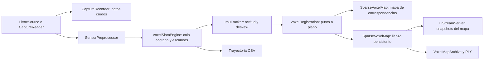

# Prototipo de SLAM con lienzo de voxels

ATLAS puede estimar el movimiento del MID-360 y acumular sus mediciones en un
mapa local fijo. Esta etapa implementa **odometría LiDAR con apoyo del giróscopo
y mapeo mediante voxel hashing**. Es la base para añadir después superficies,
objetos geométricos y referencias topográficas.

El mapa todavía no tiene cierre de bucles, relocalización global, ajuste de
controles RTK/estación total, reconocimiento neuronal ni compresión a planos o
cilindros. Su origen y orientación horizontal inicial son arbitrarios. La IMU
permite alinear la vertical con la gravedad; eso no convierte el mapa en un
levantamiento georreferenciado.

## Compilar

Desde la raíz del repositorio:

```sh
cmake --preset mac-release -DATLAS_ENABLE_LIVOX=ON -DATLAS_ENABLE_UI_STREAM=ON
cmake --build --preset mac-release
```

Usar **Release** para SLAM en vivo, reproducción y demostración: el ajuste
geométrico con Eigen necesita optimización para seguir el ritmo del sensor.
Para ejecutar las pruebas de desarrollo con las comprobaciones de Debug:

```sh
cmake --preset mac-debug -DATLAS_ENABLE_LIVOX=ON -DATLAS_ENABLE_UI_STREAM=ON -DATLAS_BUILD_TESTS=ON
cmake --build --preset mac-debug
ctest --test-dir build/mac-debug --output-on-failure
```

Eigen 3.4 es una dependencia de cabeceras. CMake busca una instalación disponible;
si no existe, obtiene la distribución oficial con SHA-256 verificado. Para
configurar sin descargar y usando una copia local, añadir
`-DFETCHCONTENT_SOURCE_DIR_ATLAS_EIGEN=/ruta/eigen` al comando de configuración.

Las configuraciones nuevas están en archivos `*_config.hpp`. Después de cambiar
un umbral, hay que recompilar y reiniciar la sesión.

## Probar con el MID-360

En la Mac, desde la raíz del proyecto, el lanzador prepara una sesión nueva:

```sh
./startAtlas.sh
```

Comprueba que la IP local configurada esté disponible y que los puertos
principales estén libres antes de iniciar el SLAM. Si falta el enlace Ethernet,
indica cómo revisarlo. Muestra la IP Wi-Fi de la Mac para conectar ATLASViewer.
La app actualizada muestra además superficies y ejes locales en vivo, calculados
por un hilo separado aproximadamente cada segundo. Los controles **Puntos /
Superficies / Ejes** seleccionan capas; la vista es provisional y el modelo
detallado se crea al terminar. Ver [geometría estructural](STRUCTURAL_GEOMETRY.md).
`./startAtlas.sh --check` realiza solamente esas comprobaciones locales, sin
arrancar el sensor ni crear archivos de sesión; no confirma que el LiDAR envíe
datos. El script usa Python 3 y el ejecutable Release ya compilado.

Cada ejecución guarda al terminar con **Ctrl+C** una sesión en
`output/fecha-hora-XXXXXX/`. Después del cierre del sensor reconstruye superficies
y marcos de referencia, y crea `geometria/scene.glb`, `scene.json`, `quality.json`
y `viewer.html`. También conserva `trayectoria.csv`, `slam_session.txt` y
`session.json`. Espera a que la reconstrucción termine.

El PLY intermedio `mediciones.ply` se retira únicamente si pasan los controles
de cobertura, soporte geométrico, reducción de tamaño y estado del SLAM. Si no
pasan, permanece como respaldo y `session.json` indica `needs_review`.
`./startAtlas.sh --keep-source` conserva siempre el PLY y el archivo de voxels.
Las capturas antiguas nunca se eliminan. La instalación inicial se hace con
`./scripts/setupGeometry.sh` (Python 3.12; el entorno de esta Mac ya está preparado).
Ver [geometría estructural](STRUCTURAL_GEOMETRY.md) para parámetros y límites.

No hay límite de 90 segundos: la sesión continúa hasta detenerla o hasta un
error. Este lanzador no graba paquetes crudos; para conservarlos, usar también
`--record` en el comando manual que sigue. Sin conectar el equipo se puede
reconstruir una captura anterior con `./createGeometry.sh output/SESION/mapa.ply`.

Con la red del sensor configurada y sin otro proceso usando sus puertos:

```sh
mkdir -p captures output
./build/mac-release/apps/atlas_livox_probe config/livox/mid360.json \
  --slam \
  --record captures/mid360-sesion-01 \
  --map output/mid360-sesion-01-map \
  --ply output/mid360-sesion-01.ply \
  --trajectory output/mid360-sesion-01-trajectory.csv
```

Cada sesión necesita destinos nuevos. El directorio de captura, el directorio
del mapa y los archivos de salida no deben existir. El directorio padre de los
archivos PLY y CSV sí debe existir. Cambiar `sesion-01` para la siguiente captura.

1. Dejar el sensor inmóvil al iniciar. Se requieren al menos **0,5 segundos**
   de muestras IMU suficientemente estables; mantenerlo quieto hasta ver
   `state=tracking`.
2. Observar superficies en varias direcciones: suelo, paredes y esquinas.
   Una pared aislada puede dejar movimientos sin determinar.
3. Moverlo lentamente, manteniendo solapamiento con la geometría ya observada.
4. Finalizar con **Ctrl+C**. Se detiene el sensor, se drenan las colas y se
   escriben las salidas solicitadas.

La consola informa una vez por segundo:

| Campo | Significado |
| --- | --- |
| `state` | `uninitialized`, `initializing`, `tracking` o `lost` |
| `scans`, `accepted`, `rejected` | Escaneos procesados y resultado de su validación |
| `position_m` | Posición estimada del sensor en el marco local, en metros |
| `voxels`, `blocks` | Tamaño del lienzo conservado |
| `rmse_m` | Error de ajuste punto-plano del último intento de registro |
| `correspondences` | Correspondencias geométricas utilizadas |
| `rejected_events` | Eventos de entrada rechazados; no equivalen a escaneos descartados |
| `message` | Motivo de espera, pérdida de seguimiento o fallo |

Un escaneo rechazado no se integra al mapa. Una brecha de seguimiento mayor que
el intervalo permitido solicita reiniciar SLAM; este prototipo no se relocaliza
automáticamente. En el CLI, detener con Ctrl+C y empezar otra sesión conserva
los resultados de la anterior. El código también expone `reset()` para futuros
controles de aplicación. Antes de llamar a `reset()` deben detenerse los
productores y los lectores simultáneos del motor; no debe competir con callbacks,
consultas del mapa o del estado.

La grabación `--record` conserva LiDAR e IMU **antes del preprocesado**, separada
del mapa y de la reducción de puntos del visor. Es la entrada para repetir el
experimento con otra configuración. El formato y sus verificaciones se
describen en [Capturas y sincronización](CAPTURE_AND_SYNCHRONIZATION.md).

El probe filtra además los puntos marcados con **baja confianza** por el MID-360,
antes de enviarlos a SLAM o al visor. La misma política se activa al reproducir
capturas cuyo manifiesto comienza con `source=MID-360 raw bus`; también funciona
con las capturas anteriores, que ya conservaban el `tag`. Las fuentes genéricas
no interpretan estos bits por defecto.

Según el [protocolo MID-360, Tag Information](https://livox-wiki-en.readthedocs.io/en/latest/tutorials/new_product/mid360/livox_eth_protocol_mid360.html),
los campos de dos bits 0–1, 2–3 y 4–5 describen confianza por adherencia entre
objetos, partículas pequeñas y otras causas. Se rechaza el punto si alguno vale
2 (baja confianza); se conserva la confianza media (1). Los valores reservados
(3) y los bits reservados 6–7 no se interpretan como ruido. Esta política no debe
aplicarse a otros modelos ni a formatos de tag distintos sin verificar su protocolo.

La opción `filter_mid360_low_confidence_tags` está en
`sensor_preprocessor_config.hpp`; el probe la activa explícitamente. El resumen
de consola muestra `lidar_points_rejected_by_tag`, un subconjunto del total de
rechazos: primero se descartan puntos inválidos o a menos de 60 cm, sin contarlos
otra vez por tag. El filtro conserva tiempos y offsets originales. No detecta
objetos en movimiento ni elimina rastros de un mapa ya guardado; para aplicar el
cambio a una sesión anterior hay que reconstruirla desde la captura cruda.

## Ver el mapa en el iPhone

Abrir y ejecutar el proyecto:

```sh
open apps/ios/ATLASViewer/ATLASViewer.xcodeproj
```

Con la Mac y el iPhone en la misma red, el visor puede encontrar el servidor por
Bonjour o conectarse mediante la IP de la Mac, puerto TCP `47777`.

Al recibir un mapa, el encabezado cambia a **ATLAS · Mapa SLAM**. Arrastrar rota
la vista y pellizcar cambia el zoom. Cada mensaje sustituye el mapa mostrado.
El visor recibe como máximo 50.000 puntos de muestra cada 250 ms; ese límite no
reduce el mapa guardado.

El indicador de SLAM muestra **Inicializando**, **Seguimiento activo** o
**Seguimiento perdido**, separado del estado de conexión TCP. Si se pierde el
seguimiento, conserva el último mapa válido y lo identifica como detenido;
seguir recibiendo snapshots no confirma nuevas poses. **Detalle del seguimiento**
despliega el motivo del estimador y los conteos de escaneos. Un rechazo temporal
puede recuperarse; el motivo específico indica cuándo es necesario reiniciar.

La versión actual también muestra el estado del estimador: esperando datos,
inicializando, seguimiento activo o seguimiento perdido. **Conectado** describe
únicamente la red. El detalle del seguimiento incluye el motivo y los escaneos
aceptados/rechazados; cuando se pierde, el mapa visible conserva sólo las poses
válidas anteriores. Un rechazo aislado puede recuperarse; si el intervalo sin
poses aceptadas excede el límite, el motivo indica que hay que reiniciar.

El modo de mapa usa una vista orbital. Las coordenadas del mapa son fijas en el
mundo local y no se proyectan sobre la cámara mediante la calibración estática
LiDAR-cámara. Una superposición correcta necesitaría además la pose de la cámara
en ese mismo marco. El complemento RGB envía imágenes al servidor para colorear
y contrastar evidencia cuando se verifica la calibración; no añade esa
superposición de realidad aumentada.

Sin `--slam`, el probe conserva el flujo de visualización LiDAR anterior.

## Reprocesar una captura

Para reconstruir el mapa sin el sensor:

```sh
./build/mac-release/apps/atlas_capture replay captures/mid360-sesion-01 \
  --speed 0 --slam \
  --map output/replay-01-map \
  --ply output/replay-01.ply \
  --trajectory output/replay-01-trajectory.csv
```

`--speed 0` procesa sin esperar los intervalos originales. El CLI aplica
contrapresión por lotes para que la lectura del archivo no desborde la cola de
SLAM. Para observar el avance en el iPhone, añadir `--ui` y usar `--speed 1`.
Los snapshots del mapa se limitan por tiempo real, también en reproducción
acelerada. Al terminar el archivo se procesa el último escaneo que sea válido.

El proceso devuelve un error si ocurre un fallo fatal, no acepta ningún escaneo
o termina con el seguimiento perdido. Los eventos de entrada rechazados se
informan por separado; algunos descartes pueden ser recuperables.

Si se detiene por un fallo o pérdida de seguimiento y ya tiene geometría válida,
exporta únicamente los escaneos aceptados y avisa `partial local map; tracking
stopped`. Si no hay puntos aceptados, no crea el archivo de mapa ni el PLY; un
CSV solicitado puede contener sólo su encabezado y se informa como vacío.
Un código de salida exitoso, por sí solo, no valida la calidad de la trayectoria.

## Demostración sintética

```sh
./build/mac-release/apps/atlas_slam_demo output/slam-demo-01
```

La demostración genera una habitación con un obstáculo, una trayectoria conocida,
movimiento dentro de cada escaneo y ruido determinista. Comienza con el sensor
inmóvil. Ejecuta el mismo motor de SLAM y produce:

- `voxel-map/`: archivo del lienzo.
- `map.ply`: un punto medido por voxel ocupado, con reflectividad.
- `trajectory.csv`: poses aceptadas.
- `ground-truth.csv`: poses conocidas para comparar.
- `metrics.txt`: errores de trayectoria y superficie, conteos y resultado.

El directorio del mapa incluye `slam_session.txt`: identifica el marco local,
la ausencia de georreferenciación y cierre de bucles, los tamaños de voxel,
los umbrales de keyframe y el estado al guardar.

Estas métricas validan un caso controlado. No representan la precisión real del
MID-360 ni sustituyen puntos de control independientes. El comando
`atlas_capture synth` es una prueba distinta del formato de captura: su plano
simple y corta duración no constituyen una prueba de SLAM.

## Organización en clases



| Clase | Responsabilidad |
| --- | --- |
| `VoxelSlamEngine : ISlamEngine` | Recibe eventos en callbacks cortos, los procesa en un hilo, construye escaneos, valida poses e integra sólo resultados aceptados |
| `ImuTracker` | Estima sesgo inicial del giróscopo y vertical, interpola rotaciones y comprueba cobertura temporal |
| `VoxelRegistration` | Busca vecinos por hashing, estima planos locales y ajusta una transformación con pérdidas robustas y comprobaciones de degeneración |
| `SparseVoxelMap` | Índice espacial disperso de bloques y voxels; almacena puntos en coordenadas fijas |
| `VoxelMapArchive` | Guarda el lienzo en un directorio nuevo |
| `UiStreamServer` | Publica snapshots completos con la bandera de coordenadas mundo, reemplazando snapshots pendientes |

La rotación y la compensación rotacional del movimiento durante el escaneo usan
el giróscopo. La traslación se predice con velocidad constante estimada de poses
aceptadas y se corrige geométricamente. **No se obtiene la posición integrando
dos veces el acelerómetro**, ni se implementa aún un filtro inercial completo.
LiDAR e IMU deben compartir identificador de sensor y reloj. La rotación
IMU→LiDAR es configurable; su valor identidad requiere ejes coorientados.

La inicialización exige una ventana quieta de 0,5 s y al menos 50 muestras.
El sesgo candidato es la media vectorial del giro, limitada a 0,05 rad/s;
se comprueban por separado los residuos respecto a esa media: máximo individual
de 0,03 rad/s y desviación estándar vectorial de 0,01 rad/s. Así un offset
estable, como los aproximadamente 0,036 rad/s medidos en el MID-360 de prueba,
puede calibrarse sin confundirlo con movimiento variable. Los límites de gravedad
(±1 m/s²), dispersión vectorial de aceleración (0,20 m/s²), huecos temporales
(30 ms) y soporte geométrico para aceptar el primer escaneo siguen activos.
**Hay que mantener el equipo inmóvil**: la IMU por sí sola no distingue un giro
horizontal constante suficientemente lento de un sesgo. La cota absoluta rechaza
giros constantes fuertes, pero no elimina esa ambigüedad ni sustituye una
calibración verificada.

El mapa de correspondencias se actualiza cuando el movimiento acumulado desde
su último keyframe supera 15 cm o 0,10 rad **si la capa temporal está desactivada**.
En ese modo el lienzo incorpora todos los escaneos aceptados. Con la capa temporal
activada (valor predeterminado), el mapa de correspondencias recibe las muestras
que alcanzan confirmación temporal, aunque no se haya cruzado un umbral de
keyframe. La pose sigue estimándose en todos los escaneos. Los keyframes aquí
no constituyen un grafo de poses ni un mecanismo de cierre de bucles.

## Lienzo temporal y retirada de rastros — 28 de octubre de 2026

`TemporalCanvas` conserva una capa de candidatos separada del lienzo confirmado.
Cada candidato retiene una medición original (incluido RGB opcional si lo aporta
el llamador), su primera/última observación y evidencia de escaneos distintos.
Con los valores predeterminados, una celda necesita tres escaneos en dos segundos
para entrar al lienzo. Cien puntos del mismo escaneo cuentan como una observación.
Una celda confirmada conserva su muestra: un retorno nuevo en esa misma celda no
sobrescribe el fondo. No hay identificación semántica de objetos; tampoco se
pueden separar dos superficies por debajo de la resolución de una celda. La
primera etapa del filtro fue geométrica; el complemento RGB añadido después se
documenta en [CAMERA_LIDAR_FUSION.md](CAMERA_LIDAR_FUSION.md).

Un rastro confirmado vuelve a **desconocido/sin geometría** tras tres escaneos
con evidencia contradictoria dentro de dos segundos. Esa evidencia requiere un
rayo medido que pase cerca de la muestra anterior y termine más allá de ella.
No se recorre espacio detrás de un retorno; las superficies ocultas se conservan.
Dejar de recibir puntos en una zona no la convierte en espacio libre. Los
candidatos sin confirmar caducan después de dos segundos sin observaciones;
la geometría confirmada nunca caduca solamente por edad.

La retirada afecta al lienzo y a las muestras correspondientes del mapa de
registro. Como sus resoluciones difieren, se filtran las muestras de las celdas
gruesas, conservando las pertenecientes a otras celdas finas. Los bloques que
quedan vacíos se liberan. Los snapshots completos del visor y las exportaciones
PLY/archivo contienen la geometría confirmada actual, de modo que un rastro
retirado no se vuelve a mostrar ni aparece al recargar el archivo.

La primera pose usa un mapa de registro provisional para evitar depender de
confirmaciones que todavía no existen. Si una candidata caduca pero sostiene
esa referencia provisional, se conserva solo como soporte de localización y
evidencia de visibilidad, fuera del lienzo y de las exportaciones. Se retira
cuando queda contradicha, nunca por simple falta de observaciones. La consola
cuenta esas celdas como `provisional_reference`. Por eso el lienzo puede verse vacío
durante los primeros escaneos aceptados. La confirmación reduce la densidad frente
a acumular todos los retornos; superficies observadas una sola vez no se exportan.

La actualización temporal ocurre solo después de validar la pose, cobertura IMU,
velocidad y presupuestos. Se congela si el registro aceptado supera 4 cm RMS o un
número de condición de 10.000; los escaneos rechazados no modifican sus capas.
La consola distingue `candidates`, `cleared` (celdas confirmadas retiradas),
`contradicted_candidates`, `expired_candidates` y `temporal_skipped`.

Los rayos usan el origen estimado del sensor al adquirir cada retorno, conservando
su offset durante el deskew. La estimación de traslación sigue siendo la predicción
de velocidad constante del prototipo. El recorrido se limita a 2.000 rayos por
escaneo, rotando la selección, 2.048 pasos por rayo y 40 m. Se excluyen los primeros
60 cm y los últimos 20 cm antes de la superficie; la tolerancia lateral es 3 cm.
La capa tiene un presupuesto de 300.000 celdas. Los parámetros están en
[`temporal_canvas_config.hpp`](../core/slam/include/atlas/slam/temporal_canvas_config.hpp)
y se incluyen mediante `VoxelSlamConfig::temporal_canvas`. `enabled=false` permite
comparar con el acumulador anterior. Hay que recompilar después de cambiar defaults.

Esto implementa limpieza geométrica por visibilidad, no reconocimiento completo
de personas ni seguimiento de instancias. Un rastro confirmado que nunca se vuelva
a observar con rayos que lo contradigan puede permanecer. Poses erróneas aceptadas,
incidencia rasante y superficies transparentes requieren validación física; los
umbrales de calidad no son una covarianza ni una garantía de inmovilidad.

Las pruebas `TemporalCanvasTest` cubren promoción, oclusión, conservación del
fondo en una misma celda, eliminación de soporte en ambas resoluciones, límites,
poses no fiables, coordenadas negativas, exportación y reinicio. Una prueba del
motor completo introduce un panel que oculta la habitación, lo confirma y lo
retira al reaparecer el fondo. La captura física anterior sigue perdiendo
seguimiento: esta limpieza no añade relocalización ni corrige por sí sola ese fallo.

Validación de esta implementación: 11/11 pruebas pasan en Release y con
AddressSanitizer/UndefinedBehaviorSanitizer. El panel de la prueba integrada pasa
de 77 voxels confirmados a cero, con el fondo conservado. El replay de
`iphone-motion-01` termina con 386 escaneos aceptados y 349 rechazados, estado
`lost`; se exportó el mapa parcial a `build/slam-validation/temporal-20261028-final-map`
y `temporal-20261028-final.ply`. Los 7.818 borrados acumulados son decisiones
geométricas sobre celdas confirmadas, no objetos identificados ni una medida de
exactitud del filtro: esa captura no tiene etiquetas de movimiento de referencia.
En esa validación inicial del filtro temporal no se realizó una nueva prueba
física del sensor. Las adquisiciones posteriores del 28 de octubre se describen
en la sección de validación física actual, más abajo.

Al detener una captura, la IMU puede terminar justo antes de un límite entre
escaneos, dejando pendientes un escaneo completo y otro parcial. Al cerrar se
descartan los pendientes cuyo final exceda la última IMU como máximo 30 ms,
siempre que haya cobertura continua desde la última pose aceptada y se respete
el intervalo máximo de predicción. Se conserva la última pose completa y un
estado `lost` anterior no se borra. No se extrapolan muestras IMU ni se integran
esos escaneos. Los huecos internos, la falta de historia previa y una cola
prolongada sin IMU siguen provocando rechazo de seguimiento.

## Configuración y escala del lienzo

| Archivo | Ajustes principales |
| --- | --- |
| [`voxel_slam_config.hpp`](../core/slam/include/atlas/slam/voxel_slam_config.hpp) | Tamaños de voxel, duración de escaneos, rangos, colas, límites de mapas e inicialización IMU |
| [`voxel_registration_config.hpp`](../core/slam/include/atlas/slam/voxel_registration_config.hpp) | Correspondencias, ajuste robusto, convergencia y observabilidad |
| [`sparse_voxel_map_config.hpp`](../core/slam/include/atlas/slam/sparse_voxel_map_config.hpp) | Parámetros generales del contenedor espacial y límites del lienzo |
| [`slam_app_config.hpp`](../apps/common/slam_app_config.hpp) | Frecuencia del visor y consola, puntos por snapshot y lotes de replay |
| [`ui_stream_server_config.hpp`](../core/ui-coms/atlas-stream/include/atlas/ui/ui_stream_server_config.hpp) | Puerto, buffers, intervalo de envío y timeout TCP |
| [`slam_demo_config.hpp`](../apps/slam_demo/slam_demo_config.hpp) | Escena, movimiento, ruido y tolerancias de la demostración |

Los valores iniciales son:

- Lienzo: **5 cm**, un punto retenido por voxel ocupado.
- Mapa de correspondencias: **20 cm**, hasta ocho muestras por voxel.
- Reducción de entrada: **8 cm**.
- Escaneo nominal: **100 ms**.
- Rango de integración: **0,60 a 40 m**.
- Cola SLAM: **32 MiB** de presupuesto de eventos.
- Límites: 20.000 bloques del lienzo, 8.000 bloques de correspondencias y
  100.000 poses.

Cada bloque del contenedor contiene 8 × 8 × 8 celdas: el bloque del lienzo mide
40 cm de lado con la configuración anterior. Las celdas no observadas se
mantienen desconocidas; no son espacio libre confirmado. Los presupuestos
limitan el crecimiento, pero no equivalen a un límite exacto de memoria del
proceso. El motor usa mapas residentes; todavía no integra la caché paginada
como backend del estimador.

La cuadrícula general de **un metro** de la propuesta puede añadirse como índice
superior de regiones, conservando esta resolución fina para el registro. Cambiar
el voxel del lienzo a un metro reduciría el detalle almacenado: no crea por sí
solo una jerarquía de objetos.

La siguiente etapa es conectar `PrimitiveMap` y sus validaciones a este lienzo:
agrupar evidencia en planos, cilindros y otras superficies con límites,
incertidumbre y procedencia. El prototipo actual conserva las mediciones para
que esa reducción geométrica pueda verificarse antes de sustituirlas.

## Validación del prototipo — 20 de octubre de 2026

- Las diez pruebas de CTest pasaron en Release y con AddressSanitizer y
  UndefinedBehaviorSanitizer. Cubren registro con seis grados de libertad,
  degeneración, deskew, datos inválidos, pérdida de IMU, límites de cola,
  cambios de reloj, exportación y protocolos.
- La demostración sintética aceptó 35 de 40 escaneos; los cinco iniciales
  corresponden a la espera de inicialización. El error RMS de posición fue
  3,3 mm y el error RMS respecto a las superficies conocidas, 2,3 mm.
  Son resultados de esa escena artificial, no una especificación del sensor.
- Con el MID-360 conectado se procesaron aproximadamente 34 segundos:
  332 escaneos aceptados, ocho rechazados, 35.640 voxels ocupados y estado
  final `tracking`, sin fallo fatal. Un cliente TCP recibió y validó ocho
  snapshots con coordenadas finitas y la bandera de mapa en marco local.
- El visor compiló para iOS Simulator y para el iPhone 14 Pro físico. Se
  instaló, abrió y conectó por Bonjour; dos capturas de pantalla comprobaron
  geometría renderizada y avance del contador de frame de 44 a 159.
  Los colores de esa vista corresponden a reflectividad, sin fusión RGB.
- Una prueba posterior con movimiento manual del LiDAR mostró pérdida de
  seguimiento. La captura `iphone-motion-01/` conserva los datos para repetirla;
  `iphone-motion-01-map/` contiene sólo el mapa parcial aceptado. La conexión
  de red del visor permaneció activa, por lo que estar conectado no demuestra
  que el estimador siga aceptando poses.
- La reproducción identificó dos rechazos consecutivos por soporte geométrico:
  370/1972 correspondencias y después 354/1775, ambos debajo del 20% exigido.
  A continuación se superó el intervalo de predicción de 0,30 s. La mejora de
  diagnóstico conserva ahora la primera causa; el replay mantuvo exactamente
  los mismos 376 escaneos aceptados, 359 rechazados y pose final. No se
  relajaron los criterios de aceptación para ocultar esta pérdida.
- El nuevo indicador de seguimiento y los diagnósticos se prepararon después
  de esa prueba física. Su instalación y comprobación visual en el iPhone
  quedaron pendientes al terminar aquella fase del 20 de octubre; el enlace y
  envío de estados se comprobaron de nuevo el 28 de octubre, como se indica abajo.

Los artefactos locales de esta ejecución están en `build/slam-validation/`:
`synthetic-02/`, `mid360-raw-02/`, `live-session-03-map/`,
`live-session-03.ply`, `live-session-03.csv` y
`live-session-03-stream.json`. El directorio `build/` está excluido de Git;
estos resultados no se distribuyen con el código.

La prueba física confirma recepción, procesamiento, exportación y visualización
en el iPhone. No incluyó una trayectoria medida con referencia externa: todavía
no permite afirmar precisión topográfica. La pérdida observada al mover el
sensor limita su uso a experimentos supervisados hasta mejorar y validar el
seguimiento durante recorridos.

## Validación física actual — 28 de octubre de 2026

Se renovó la instalación de ATLASViewer en el iPhone 14 Pro y se retomó la
adquisición del MID-360. La captura `resumed-20261028-155720` permitió identificar
un sesgo estacionario de giro de aproximadamente 0,036 rad/s, superior al antiguo
límite aplicado al dato bruto. Tras separar bias y dispersión, su replay de
45 s pasó de cero a 443 poses aceptadas de 450 escaneos y produjo 45.339 voxels.

La siguiente prueba física, `corrected-live-20261028-160629`, duró 90 s y capturó
18.118.176 puntos LiDAR y 18.118 muestras IMU. Se aceptaron 892 de 900 escaneos,
con 44.882 voxels y seguimiento activo durante la adquisición. La trayectoria
abarca 89,787 s y un movimiento limitado a aproximadamente
0,41 × 0,24 × 0,44 m. El último RMSE de registro fue 0,01274 m; es consistencia
interna del ajuste, no una medición de precisión absoluta ni de un recorrido
extenso.

El iPhone recibió 199 snapshots y 199 estados SLAM; el servidor recibió
289 imágenes RGB y rechazó cero. Las imágenes aún no se aplicaron a la nube
(`colored=0`): la extrínseca real y la correspondencia medida entre relojes
siguen sin verificar. La recepción de RGB comprueba el transporte, no la calidad
del complemento visual del filtro de movimiento.

La prueba reveló además un fallo de estado al cerrar: dos escaneos pendientes
quedaban sin cobertura al final, aunque el último punto LiDAR sólo excedía la
última IMU en 0,48088 ms. No hubo huecos IMU superiores a 30 ms; el máximo fue
6,034 ms. La excepción de cierre admitía un único pendiente y marcaba `lost`
al encontrar dos. La corrección comprueba toda la cobertura previa y descarta
esa cola corta sin borrar un fallo de seguimiento anterior.

El replay completo de esa misma grabación, con el cierre corregido, terminó en
`tracking` y código de salida cero: conservó exactamente las 892 poses y los
44.882 voxels. La trayectoria CSV, el PLY y `map.atlas` son idénticos byte a byte
a los exportados en vivo; sólo cambia el diagnóstico de cierre. Los seis
rechazos de inicialización y los dos descartes finales siguen contabilizados.
Los resultados están en `build/hardware-validation/eof-corrected-replay-20261028/`.
Pasaron 14/14 pruebas tanto en Release como con AddressSanitizer y
UndefinedBehaviorSanitizer, incluidas regresiones de doble cola final, huecos
internos, pérdida previa y ausencia prolongada de IMU. Esta corrección de cierre
se comprobó por replay y pruebas sintéticas, sin otra adquisición física.

Los archivos de adquisición y diagnósticos están en
`build/hardware-validation/corrected-live-20261028-160629/`; los resultados
históricos conservan el estado y código de salida que realmente produjo cada
ejecución. Estas capturas no tienen etiquetas de objetos en movimiento ni una
referencia topográfica externa: no prueban todavía la exactitud de la limpieza
dinámica o la georreferenciación.

## Complemento RGB

La integración en vivo de cámara, condiciones de calibración/sincronización y
comportamiento conservador del filtro están en [CAMERA_LIDAR_FUSION.md](CAMERA_LIDAR_FUSION.md).
El montaje paramétrico del iPhone 14 Pro y bastón de 30–40 mm está en
[hardware/rig](../hardware/rig/README.md).
