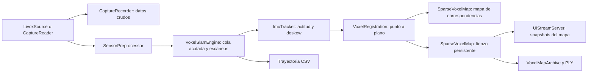

# Prototipo de SLAM con lienzo de voxels

ATLAS puede estimar el movimiento del MID-360 y acumular sus mediciones en un
mapa local fijo. Esta etapa implementa **odometría LiDAR con apoyo del giróscopo
y mapeo mediante voxel hashing**. Es la base para añadir después superficies,
objetos geométricos y referencias topográficas.

El mapa todavía no tiene cierre de bucles, relocalización global, ajuste de
controles RTK/estación total, reconocimiento neuronal ni compresión a planos o
cilindros. Su origen y orientación horizontal inicial son arbitrarios. La IMU
permite alinear la vertical con la gravedad; eso no convierte el mapa en un
levantamiento georreferenciado.

## Compilar

Desde la raíz del repositorio:

```sh
cmake --preset mac-release -DATLAS_ENABLE_LIVOX=ON -DATLAS_ENABLE_UI_STREAM=ON
cmake --build --preset mac-release
```

Usar **Release** para SLAM en vivo, reproducción y demostración: el ajuste
geométrico con Eigen necesita optimización para seguir el ritmo del sensor.
Para ejecutar las pruebas de desarrollo con las comprobaciones de Debug:

```sh
cmake --preset mac-debug -DATLAS_ENABLE_LIVOX=ON -DATLAS_ENABLE_UI_STREAM=ON -DATLAS_BUILD_TESTS=ON
cmake --build --preset mac-debug
ctest --test-dir build/mac-debug --output-on-failure
```

Eigen 3.4 es una dependencia de cabeceras. CMake busca una instalación disponible;
si no existe, obtiene la distribución oficial con SHA-256 verificado. Para
configurar sin descargar y usando una copia local, añadir
`-DFETCHCONTENT_SOURCE_DIR_ATLAS_EIGEN=/ruta/eigen` al comando de configuración.

Las configuraciones nuevas están en archivos `*_config.hpp`. Después de cambiar
un umbral, hay que recompilar y reiniciar la sesión.

## Probar con el MID-360

Con la red del sensor configurada y sin otro proceso usando sus puertos:

```sh
mkdir -p captures output
./build/mac-release/apps/atlas_livox_probe config/livox/mid360.json \
  --slam \
  --record captures/mid360-sesion-01 \
  --map output/mid360-sesion-01-map \
  --ply output/mid360-sesion-01.ply \
  --trajectory output/mid360-sesion-01-trajectory.csv
```

Cada sesión necesita destinos nuevos. El directorio de captura, el directorio
del mapa y los archivos de salida no deben existir. El directorio padre de los
archivos PLY y CSV sí debe existir. Cambiar `sesion-01` para la siguiente captura.

1. Dejar el sensor inmóvil al iniciar. Se requieren al menos **0,5 segundos**
   de muestras IMU suficientemente estables; mantenerlo quieto hasta ver
   `state=tracking`.
2. Observar superficies en varias direcciones: suelo, paredes y esquinas.
   Una pared aislada puede dejar movimientos sin determinar.
3. Moverlo lentamente, manteniendo solapamiento con la geometría ya observada.
4. Finalizar con **Ctrl+C**. Se detiene el sensor, se drenan las colas y se
   escriben las salidas solicitadas.

La consola informa una vez por segundo:

| Campo | Significado |
| --- | --- |
| `state` | `uninitialized`, `initializing`, `tracking` o `lost` |
| `scans`, `accepted`, `rejected` | Escaneos procesados y resultado de su validación |
| `position_m` | Posición estimada del sensor en el marco local, en metros |
| `voxels`, `blocks` | Tamaño del lienzo conservado |
| `rmse_m` | Error de ajuste punto-plano del último intento de registro |
| `correspondences` | Correspondencias geométricas utilizadas |
| `rejected_events` | Eventos de entrada rechazados; no equivalen a escaneos descartados |
| `message` | Motivo de espera, pérdida de seguimiento o fallo |

Un escaneo rechazado no se integra al mapa. Una brecha de seguimiento mayor que
el intervalo permitido solicita reiniciar SLAM; este prototipo no se relocaliza
automáticamente. En el CLI, detener con Ctrl+C y empezar otra sesión conserva
los resultados de la anterior. El código también expone `reset()` para futuros
controles de aplicación. Antes de llamar a `reset()` deben detenerse los
productores y los lectores simultáneos del motor; no debe competir con callbacks,
consultas del mapa o del estado.

La grabación `--record` conserva LiDAR e IMU **antes del preprocesado**, separada
del mapa y de la reducción de puntos del visor. Es la entrada para repetir el
experimento con otra configuración. El formato y sus verificaciones se
describen en [Capturas y sincronización](CAPTURE_AND_SYNCHRONIZATION.md).

## Ver el mapa en el iPhone

Abrir y ejecutar el proyecto:

```sh
open apps/ios/ATLASViewer/ATLASViewer.xcodeproj
```

Con la Mac y el iPhone en la misma red, el visor puede encontrar el servidor por
Bonjour o conectarse mediante la IP de la Mac, puerto TCP `47777`.

Al recibir un mapa, el encabezado cambia a **ATLAS · Mapa SLAM**. Arrastrar rota
la vista y pellizcar cambia el zoom. Cada mensaje sustituye el mapa mostrado.
El visor recibe como máximo 50.000 puntos de muestra cada 250 ms; ese límite no
reduce el mapa guardado.

El indicador de SLAM muestra **Inicializando**, **Seguimiento activo** o
**Seguimiento perdido**, separado del estado de conexión TCP. Si se pierde el
seguimiento, conserva el último mapa válido y lo identifica como detenido;
seguir recibiendo snapshots no confirma nuevas poses. **Detalle del seguimiento**
despliega el motivo del estimador y los conteos de escaneos. Un rechazo temporal
puede recuperarse; el motivo específico indica cuándo es necesario reiniciar.

La versión actual también muestra el estado del estimador: esperando datos,
inicializando, seguimiento activo o seguimiento perdido. **Conectado** describe
únicamente la red. El detalle del seguimiento incluye el motivo y los escaneos
aceptados/rechazados; cuando se pierde, el mapa visible conserva sólo las poses
válidas anteriores. Un rechazo aislado puede recuperarse; si el intervalo sin
poses aceptadas excede el límite, el motivo indica que hay que reiniciar.

El modo de mapa usa una vista orbital. Las coordenadas del mapa son fijas en el
mundo local y no se proyectan sobre la cámara mediante la calibración estática
LiDAR-cámara. Una superposición correcta necesitaría además la pose de la cámara
en ese mismo marco. La captura de cámara sigue siendo independiente.

Sin `--slam`, el probe conserva el flujo de visualización LiDAR anterior.

## Reprocesar una captura

Para reconstruir el mapa sin el sensor:

```sh
./build/mac-release/apps/atlas_capture replay captures/mid360-sesion-01 \
  --speed 0 --slam \
  --map output/replay-01-map \
  --ply output/replay-01.ply \
  --trajectory output/replay-01-trajectory.csv
```

`--speed 0` procesa sin esperar los intervalos originales. El CLI aplica
contrapresión por lotes para que la lectura del archivo no desborde la cola de
SLAM. Para observar el avance en el iPhone, añadir `--ui` y usar `--speed 1`.
Los snapshots del mapa se limitan por tiempo real, también en reproducción
acelerada. Al terminar el archivo se procesa el último escaneo que sea válido.

El proceso devuelve un error si ocurre un fallo fatal, no acepta ningún escaneo
o termina con el seguimiento perdido. Los eventos de entrada rechazados se
informan por separado; algunos descartes pueden ser recuperables.

Si se detiene por un fallo o pérdida de seguimiento y ya tiene geometría válida,
exporta únicamente los escaneos aceptados y avisa `partial local map; tracking
stopped`. Si no hay puntos aceptados, no crea el archivo de mapa ni el PLY; un
CSV solicitado puede contener sólo su encabezado y se informa como vacío.
Un código de salida exitoso, por sí solo, no valida la calidad de la trayectoria.

## Demostración sintética

```sh
./build/mac-release/apps/atlas_slam_demo output/slam-demo-01
```

La demostración genera una habitación con un obstáculo, una trayectoria conocida,
movimiento dentro de cada escaneo y ruido determinista. Comienza con el sensor
inmóvil. Ejecuta el mismo motor de SLAM y produce:

- `voxel-map/`: archivo del lienzo.
- `map.ply`: un punto medido por voxel ocupado, con reflectividad.
- `trajectory.csv`: poses aceptadas.
- `ground-truth.csv`: poses conocidas para comparar.
- `metrics.txt`: errores de trayectoria y superficie, conteos y resultado.

El directorio del mapa incluye `slam_session.txt`: identifica el marco local,
la ausencia de georreferenciación y cierre de bucles, los tamaños de voxel,
los umbrales de keyframe y el estado al guardar.

Estas métricas validan un caso controlado. No representan la precisión real del
MID-360 ni sustituyen puntos de control independientes. El comando
`atlas_capture synth` es una prueba distinta del formato de captura: su plano
simple y corta duración no constituyen una prueba de SLAM.

## Organización en clases



| Clase | Responsabilidad |
| --- | --- |
| `VoxelSlamEngine : ISlamEngine` | Recibe eventos en callbacks cortos, los procesa en un hilo, construye escaneos, valida poses e integra sólo resultados aceptados |
| `ImuTracker` | Estima sesgo inicial del giróscopo y vertical, interpola rotaciones y comprueba cobertura temporal |
| `VoxelRegistration` | Busca vecinos por hashing, estima planos locales y ajusta una transformación con pérdidas robustas y comprobaciones de degeneración |
| `SparseVoxelMap` | Índice espacial disperso de bloques y voxels; almacena puntos en coordenadas fijas |
| `VoxelMapArchive` | Guarda el lienzo en un directorio nuevo |
| `UiStreamServer` | Publica snapshots completos con la bandera de coordenadas mundo, reemplazando snapshots pendientes |

La rotación y la compensación rotacional del movimiento durante el escaneo usan
el giróscopo. La traslación se predice con velocidad constante estimada de poses
aceptadas y se corrige geométricamente. **No se obtiene la posición integrando
dos veces el acelerómetro**, ni se implementa aún un filtro inercial completo.
LiDAR e IMU deben compartir identificador de sensor y reloj. La rotación
IMU→LiDAR es configurable; su valor identidad requiere ejes coorientados.

El mapa de correspondencias se actualiza cuando el movimiento acumulado desde
su último keyframe supera 15 cm o 0,10 rad. La pose sigue estimándose en todos los
escaneos; los movimientos pequeños no se congelan. El lienzo incorpora todos los
escaneos aceptados. Esta separación evita realimentar cada fluctuación de registro
al mapa usado como referencia. Los keyframes aquí son una política de actualización
local, no un grafo de poses ni un mecanismo de cierre de bucles.

Al detener una captura, el último paquete LiDAR puede extenderse unos milisegundos
más allá de la última IMU. Ese escaneo final se descarta explícitamente si falta
cobertura; se conserva la última pose completa. Una brecha durante la captura
sí provoca rechazo de seguimiento.

## Configuración y escala del lienzo

| Archivo | Ajustes principales |
| --- | --- |
| [`voxel_slam_config.hpp`](../core/slam/include/atlas/slam/voxel_slam_config.hpp) | Tamaños de voxel, duración de escaneos, rangos, colas, límites de mapas e inicialización IMU |
| [`voxel_registration_config.hpp`](../core/slam/include/atlas/slam/voxel_registration_config.hpp) | Correspondencias, ajuste robusto, convergencia y observabilidad |
| [`sparse_voxel_map_config.hpp`](../core/slam/include/atlas/slam/sparse_voxel_map_config.hpp) | Parámetros generales del contenedor espacial y límites del lienzo |
| [`slam_app_config.hpp`](../apps/common/slam_app_config.hpp) | Frecuencia del visor y consola, puntos por snapshot y lotes de replay |
| [`ui_stream_server_config.hpp`](../core/ui-coms/atlas-stream/include/atlas/ui/ui_stream_server_config.hpp) | Puerto, buffers, intervalo de envío y timeout TCP |
| [`slam_demo_config.hpp`](../apps/slam_demo/slam_demo_config.hpp) | Escena, movimiento, ruido y tolerancias de la demostración |

Los valores iniciales son:

- Lienzo: **5 cm**, un punto retenido por voxel ocupado.
- Mapa de correspondencias: **20 cm**, hasta ocho muestras por voxel.
- Reducción de entrada: **8 cm**.
- Escaneo nominal: **100 ms**.
- Rango de integración: **0,60 a 40 m**.
- Cola SLAM: **32 MiB** de presupuesto de eventos.
- Límites: 20.000 bloques del lienzo, 8.000 bloques de correspondencias y
  100.000 poses.

Cada bloque del contenedor contiene 8 × 8 × 8 celdas: el bloque del lienzo mide
40 cm de lado con la configuración anterior. Las celdas no observadas se
mantienen desconocidas; no son espacio libre confirmado. Los presupuestos
limitan el crecimiento, pero no equivalen a un límite exacto de memoria del
proceso. El motor usa mapas residentes; todavía no integra la caché paginada
como backend del estimador.

La cuadrícula general de **un metro** de la propuesta puede añadirse como índice
superior de regiones, conservando esta resolución fina para el registro. Cambiar
el voxel del lienzo a un metro reduciría el detalle almacenado: no crea por sí
solo una jerarquía de objetos.

La siguiente etapa es conectar `PrimitiveMap` y sus validaciones a este lienzo:
agrupar evidencia en planos, cilindros y otras superficies con límites,
incertidumbre y procedencia. El prototipo actual conserva las mediciones para
que esa reducción geométrica pueda verificarse antes de sustituirlas.

## Validación del prototipo — 20 de octubre de 2026

- Las diez pruebas de CTest pasaron en Release y con AddressSanitizer y
  UndefinedBehaviorSanitizer. Cubren registro con seis grados de libertad,
  degeneración, deskew, datos inválidos, pérdida de IMU, límites de cola,
  cambios de reloj, exportación y protocolos.
- La demostración sintética aceptó 35 de 40 escaneos; los cinco iniciales
  corresponden a la espera de inicialización. El error RMS de posición fue
  3,3 mm y el error RMS respecto a las superficies conocidas, 2,3 mm.
  Son resultados de esa escena artificial, no una especificación del sensor.
- Con el MID-360 conectado se procesaron aproximadamente 34 segundos:
  332 escaneos aceptados, ocho rechazados, 35.640 voxels ocupados y estado
  final `tracking`, sin fallo fatal. Un cliente TCP recibió y validó ocho
  snapshots con coordenadas finitas y la bandera de mapa en marco local.
- El visor compiló para iOS Simulator y para el iPhone 14 Pro físico. Se
  instaló, abrió y conectó por Bonjour; dos capturas de pantalla comprobaron
  geometría renderizada y avance del contador de frame de 44 a 159.
  Los colores de esa vista corresponden a reflectividad, sin fusión RGB.
- Una prueba posterior con movimiento manual del LiDAR mostró pérdida de
  seguimiento. La captura `iphone-motion-01/` conserva los datos para repetirla;
  `iphone-motion-01-map/` contiene sólo el mapa parcial aceptado. La conexión
  de red del visor permaneció activa, por lo que estar conectado no demuestra
  que el estimador siga aceptando poses.
- La reproducción identificó dos rechazos consecutivos por soporte geométrico:
  370/1972 correspondencias y después 354/1775, ambos debajo del 20% exigido.
  A continuación se superó el intervalo de predicción de 0,30 s. La mejora de
  diagnóstico conserva ahora la primera causa; el replay mantuvo exactamente
  los mismos 376 escaneos aceptados, 359 rechazados y pose final. No se
  relajaron los criterios de aceptación para ocultar esta pérdida.
- El nuevo indicador de seguimiento y los diagnósticos se prepararon después
  de esa prueba física. Su instalación y comprobación visual en el iPhone
  quedan pendientes de retomar la sesión con el usuario.

Los artefactos locales de esta ejecución están en `build/slam-validation/`:
`synthetic-02/`, `mid360-raw-02/`, `live-session-03-map/`,
`live-session-03.ply`, `live-session-03.csv` y
`live-session-03-stream.json`. El directorio `build/` está excluido de Git;
estos resultados no se distribuyen con el código.

La prueba física confirma recepción, procesamiento, exportación y visualización
en el iPhone. No incluyó una trayectoria medida con referencia externa: todavía
no permite afirmar precisión topográfica. La pérdida observada al mover el
sensor limita su uso a experimentos supervisados hasta mejorar y validar el
seguimiento durante recorridos.
